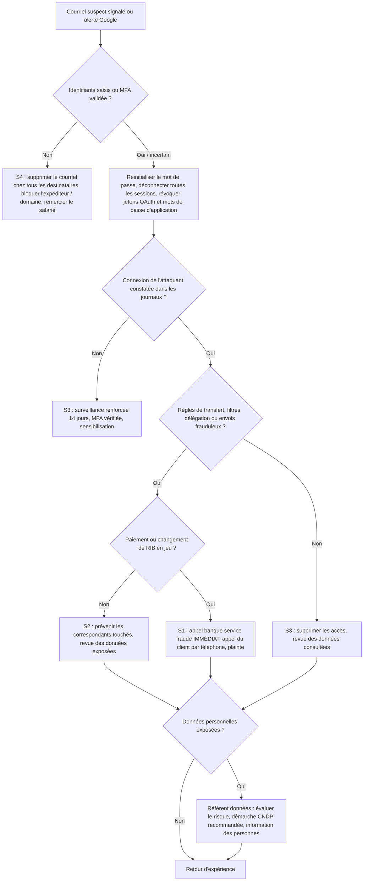

# Playbook A — Hameçonnage et compte Google Workspace compromis (BEC)

| Référence | Gravité par défaut | Fonctions CSF 2.0 | Propriétaire |
|---|---|---|---|
| AGS-PB-A | S3, S2 si compte compta/gérant, S1 si virement frauduleux | Detect (DE.CM, DE.AE), Respond (RS.MA, RS.AN, RS.MI), Recover (RC.RP) | Responsable de l'incident (RI) |

**Scénario type.** Une salariée reçoit un faux courriel « document partagé » et saisit son mot de passe Google sur une fausse page. L'attaquant se connecte, crée une règle de transfert vers une adresse externe, lit les échanges avec les clients, puis envoie depuis la vraie boîte une demande de « changement de RIB » à un client B2B (fraude au changement de RIB / faux fournisseur, forme courante de BEC, *Business Email Compromise*).

## 1. Déclencheurs et sources de détection

| Source | Signal |
|---|---|
| Salarié | Signale un courriel suspect, ou dit avoir saisi son mot de passe / validé une demande MFA inattendue |
| Client / fournisseur | Appelle pour vérifier un changement de RIB, ou reçoit des courriels étranges depuis notre domaine |
| Google Workspace — Centre d'alertes | « Suspicious login », « Leaked password », « User suspended due to suspicious activity », « Gmail potential employee spoofing », activité suspecte de règles |
| Google Workspace — journaux | Connexion depuis un pays ou un FAI inhabituel, connexions simultanées depuis deux pays, nouvelle règle de transfert ou filtre, nouvelle délégation, nouvelle application OAuth autorisée |
| Utilisateur | Messages absents de la boîte, réponses de clients à des messages jamais envoyés, alertes de sécurité Google sur le téléphone |
| Banque / compta | Virement contesté, demande de paiement inhabituelle |

## 2. Triage (15 premières minutes)

- [ ] Ouvrir l'entrée au registre : heure du signalement, auteur, compte concerné, premier constat.
- [ ] Le mot de passe a-t-il été **saisi** ? Une demande MFA a-t-elle été **validée** ? Une pièce jointe a-t-elle été **ouverte** (si oui, traiter aussi le poste comme suspect) ?
- [ ] Vérifier dans la console d'administration les connexions récentes du compte (journal « Connexions » / *Login audit*) : IP, pays, heure, type de connexion.
- [ ] Vérifier dans Gmail du compte : paramètres de **transfert**, **filtres**, **délégation**, **réponse automatique**, **signature** modifiée, dossier « Envoyés » et « Corbeille ».
- [ ] Vérifier les **applications tierces** autorisées (OAuth) et les mots de passe d'application.
- [ ] Le compte a-t-il des **privilèges** (super administrateur, accès compta, banque en ligne) ?
- [ ] Des messages frauduleux sont-ils partis vers des clients/fournisseurs ? Un **paiement** est-il en jeu ?
- [ ] Combien d'autres salariés ont reçu le même courriel ? (outil d'enquête ou recherche dans les journaux selon l'édition)
- [ ] Fixer la gravité (S1 à S4) et appeler le gérant si S1/S2.

## 3. Arbre de décision

## 4. Confinement

Ordre recommandé (les actions 1 à 4 se font en quelques minutes par l'administrateur Workspace) :

1. **Réinitialiser le mot de passe** du compte depuis la console d'administration (mot de passe long, communiqué par téléphone).
2. **Déconnecter toutes les sessions** de l'utilisateur (action « Déconnexion » / réinitialisation des cookies de connexion dans la fiche utilisateur). Changer le mot de passe seul ne coupe pas toujours immédiatement toutes les sessions ouvertes.
3. **Révoquer** les jetons des applications tierces (OAuth) inconnues, les mots de passe d'application, et vérifier les méthodes de validation en deux étapes enregistrées (téléphone ou clé ajoutés par l'attaquant).
4. **Supprimer** les règles de transfert, filtres, délégations et réponses automatiques créés par l'attaquant — **après les avoir photographiés / exportés** comme preuves.
5. Si l'attaquant est encore actif ou si le compte est un compte administrateur : **suspendre** temporairement le compte.
6. **Purger le courriel d'hameçonnage** des autres boîtes (outil d'enquête si l'édition le permet, sinon demande à chaque destinataire) et bloquer l'expéditeur / le domaine / l'URL (liste de blocage Gmail).
7. Si une pièce jointe a été ouverte : isoler le poste et appliquer le volet « poste » du playbook B (analyse antivirus complète, voire réinstallation).
8. **Fraude au virement** : appeler immédiatement la banque (service fraude) pour tenter un rappel de fonds ; prévenir par **téléphone** (numéro connu, pas celui du courriel) le client ou fournisseur concerné.

## 5. Éradication

- [ ] Vérifier qu'aucun autre compte n'a été compromis (connexions depuis les mêmes IP, même campagne).
- [ ] Vérifier que l'attaquant n'a pas créé de compte, modifié des rôles d'administration, ajouté un domaine ou une règle de routage Gmail au niveau de l'organisation.
- [ ] Vérifier le partage Drive : fichiers partagés publiquement ou vers une adresse externe depuis le compte.
- [ ] Rechercher les messages envoyés par l'attaquant pour savoir **qui** a été contacté.
- [ ] Si le mot de passe était réutilisé ailleurs (banque, site web, réseaux sociaux) : le changer partout.

## 6. Rétablissement

- [ ] Réactiver le compte avec **validation en deux étapes obligatoire**, de préférence par clé de sécurité ou application (pas SMS) pour les comptes compta et gérant.
- [ ] Surveillance renforcée 14 jours : alertes de connexion, revue quotidienne des règles Gmail du compte.
- [ ] Confirmer avec les clients / fournisseurs touchés que les coordonnées bancaires réelles n'ont pas changé.
- [ ] Clôture quand : aucune activité suspecte pendant 14 jours, correspondants informés, actions de durcissement planifiées.

Mesures de durcissement (Préparation, CSF *Protect*) : MFA obligatoire pour tous ; interdiction du transfert automatique vers l'extérieur (paramètre Gmail de l'organisation) ; SPF, DKIM, DMARC en `p=quarantine` puis `p=reject` ; bannière « expéditeur externe » ; procédure **double validation par téléphone** de tout changement de RIB ; contrôle des applications tierces autorisées.

## 7. Preuves à collecter

| Preuve | Où | Remarque |
|---|---|---|
| Courriel d'hameçonnage **avec en-têtes complets** | Gmail : « Afficher l'original », enregistrer en `.eml` | Ne pas le transférer comme simple pièce jointe : on perd des en-têtes |
| URL de la fausse page | En-tête / corps du courriel | Ne pas la visiter depuis un poste de production |
| Journal des connexions du compte | Console d'administration, rapports / journaux | Exporter en CSV avec la période d'intérêt (au moins 30 jours avant) |
| Journaux Gmail, Drive, admin, jetons OAuth | Console, page d'audit et d'enquête | Disponibilité et rétention selon l'édition |
| Captures des règles, filtres, délégations | Paramètres Gmail du compte | Avant suppression |
| Messages envoyés par l'attaquant | Dossier Envoyés, journaux | Liste des destinataires |
| Preuves de virement | Banque, compta | Ordre de virement, RIB frauduleux, échanges |

## 8. Modèles de communication

### 8.1 Courriel / message aux salariés

> **Objet : [Sécurité] Courriel frauduleux en circulation — ne pas cliquer**
>
> Bonjour à toutes et à tous,
>
> Un courriel frauduleux imitant un « document partagé » circule depuis ce matin (expéditeur : « Service Comptabilité <...> », objet : « Facture en attente »). Il conduit vers une fausse page de connexion Google.
>
> Si vous l'avez reçu : ne cliquez pas, signalez-le avec le bouton « Signaler l'hameçonnage » puis supprimez-le.
> Si vous avez cliqué ou saisi votre mot de passe : **appelez immédiatement** [nom du RI] au [numéro]. Aucun reproche ne vous sera fait : plus l'alerte est rapide, plus le risque est faible.
>
> Rappel : AgriSouss ne vous demandera jamais votre mot de passe par courriel, et tout changement de coordonnées bancaires d'un client ou fournisseur se vérifie par téléphone.
>
> [Nom], Responsable informatique

### 8.2 Courriel aux clients / partenaires concernés

> **Objet : Information importante — courriels frauduleux envoyés au nom d'AgriSouss**
>
> Madame, Monsieur,
>
> Le [date], un compte de messagerie d'AgriSouss SARL a été utilisé sans autorisation. Des messages frauduleux ont pu vous être envoyés, notamment une demande de modification de nos coordonnées bancaires.
>
> **Nos coordonnées bancaires n'ont pas changé.** Merci de ne donner suite à aucune demande de ce type et, en cas de doute, de nous appeler au [numéro fixe officiel].
>
> Nous avons sécurisé le compte concerné et renforcé nos contrôles. Si vous avez effectué un paiement sur la base d'un de ces messages, contactez votre banque sans attendre et prévenez-nous.
>
> Nous vous prions de nous excuser pour ce désagrément.
>
> [Nom], Gérant — AgriSouss SARL — [téléphone]

## 9. Check-list post-incident

- [ ] Chronologie complète : premier courriel, clic, première connexion de l'attaquant, détection, confinement.
- [ ] Cause racine : absence de MFA ? MFA par SMS contournée ? MFA « fatigue » ? Page relais (*adversary-in-the-middle*) ?
- [ ] Données consultées ou exfiltrées identifiées ; décision CNDP / information des personnes documentée.
- [ ] Plainte déposée si fraude ; suivi bancaire.
- [ ] Mesures de durcissement planifiées (MFA forte, DMARC, blocage du transfert externe, procédure RIB).
- [ ] Sensibilisation ciblée sous 2 semaines (sans stigmatiser la personne).
- [ ] Registre mis à jour ; indicateurs calculés.

## 10. Indicateurs (KPI)

| Indicateur | Définition | Cible |
|---|---|---|
| MTTD | Délai entre la première connexion de l'attaquant et la détection | < 24 h (objectif : alerte Google traitée < 1 h) |
| MTTA | Délai entre le signalement et la prise en charge par le RI | < 30 min en heures ouvrées |
| MTTC | Délai entre la détection et la coupure de toutes les sessions de l'attaquant | < 1 h |
| MTTR | Délai entre la détection et le retour à la normale (compte sécurisé, correspondants prévenus) | < 2 jours ouvrés |
| Taux de signalement | % de destinataires qui signalent un courriel d'hameçonnage (réel ou simulé) | > 50 % |
| Taux de clic | % de destinataires qui cliquent lors des campagnes de sensibilisation | < 10 % et en baisse |
