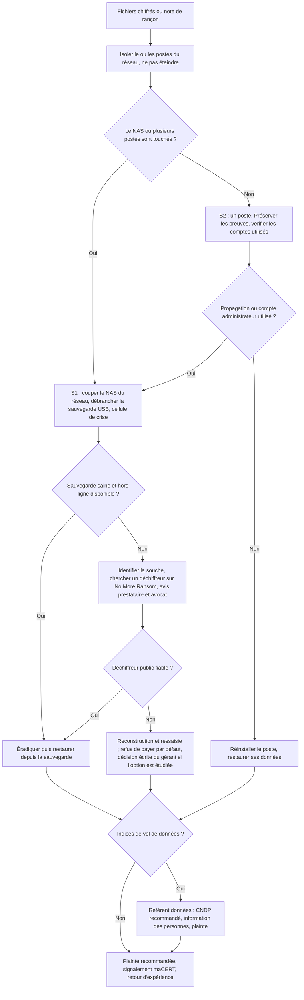

# Playbook B — Rançongiciel sur un poste ou sur le partage de fichiers (NAS)

| Référence | Gravité par défaut | Fonctions CSF 2.0 | Propriétaire |
|---|---|---|---|
| AGS-PB-B | S2 (un poste isolé), S1 (NAS, plusieurs postes, sauvegardes touchées) | Detect, Respond (RS.MA, RS.AN, RS.MI, RS.CO), Recover (RC.RP, RC.CO) | Responsable de l'incident (RI) |

**Scénario type.** Un poste du service commercial ouvre une pièce jointe piégée ou un accès distant mal protégé est exploité. Des fichiers sont renommés avec une nouvelle extension, une note de rançon apparaît, et le chiffrement atteint le dossier partagé du NAS monté en lecteur réseau. Les rançongiciels actuels pratiquent souvent la **double extorsion** : vol de données avant chiffrement, puis menace de publication.

## 1. Déclencheurs et sources de détection

| Source | Signal |
|---|---|
| Utilisateur | Fichiers illisibles, extension inconnue, fond d'écran changé, fichier `README` / `HOW_TO_DECRYPT` dans les dossiers |
| Microsoft Defender | Alerte rançongiciel, accès contrôlé aux dossiers déclenché, outil de piratage détecté, antivirus désactivé |
| NAS | Pic d'écritures / renommages, alerte de l'antivirus du NAS, quotas saturés, instantanés supprimés |
| Sauvegarde | Échec de la tâche nocturne, taille de sauvegarde anormale |
| Réseau | Poste qui scanne les autres postes, trafic sortant important la nuit |
| Externe | Message de l'attaquant, mention de l'entreprise sur un site de fuite, alerte d'un partenaire ou du maCERT |

## 2. Triage (premières minutes — agir vite)

- [ ] **Isoler immédiatement** chaque poste touché : débrancher le câble réseau, couper le Wi-Fi. **Ne pas éteindre** (la mémoire peut contenir des clés ou des traces utiles), sauf cas décrit ci-dessous.
- [ ] Si le NAS est touché ou risque de l'être : **déconnecter le NAS du réseau** (câble) et **débrancher le disque de sauvegarde USB** s'il est branché.
- [ ] Photographier la note de rançon et un exemple de fichier chiffré (nom, extension).
- [ ] Recenser : quels postes, quels partages, quels comptes utilisateurs ; depuis quand ?
- [ ] Vérifier l'état des **sauvegardes** : copie hors site intacte ? date de la dernière copie saine ? sauvegardes chiffrées ou supprimées ?
- [ ] Classer la gravité ; S1 : appeler le gérant et le prestataire, activer le groupe de crise hors bande.
- [ ] Interdire aux salariés de rallumer, rebrancher ou « tester » des postes.

**Éteindre ou non ?** La règle par défaut est d'isoler sans éteindre. Si le chiffrement est visiblement en cours et que l'isolement réseau ne l'arrête pas (chiffrement local qui continue), ou s'il est impossible de débrancher, on peut **mettre en veille prolongée** ou couper l'alimentation pour limiter les dégâts : on perd la mémoire vive, mais on sauve des fichiers. Noter la décision et l'heure.

## 3. Arbre de décision

## 4. Confinement

1. **Isoler** les postes touchés (fait au triage) ; si nécessaire isoler tout le réseau du bureau d'Internet (couper le lien de la box) le temps de comprendre.
2. **Couper le NAS** du réseau et **protéger les sauvegardes** : débrancher les disques USB, suspendre les tâches de synchronisation (un client de synchronisation cloud peut propager les fichiers chiffrés vers le cloud).
3. **Désactiver les comptes** utilisés par l'attaque (compte de l'utilisateur, compte administrateur local ou du NAS) et changer les mots de passe **depuis un poste sain**.
4. Bloquer les accès distants (bureau à distance exposé, VPN, logiciel de télémaintenance) jusqu'à vérification.
5. Garder une **liste à jour** des postes : isolé / sain vérifié / à réinstaller.
6. Ne pas entrer en contact avec l'attaquant sans décision du directeur de crise et avis de l'avocat.

## 5. Éradication

- [ ] **Identifier la souche** à partir de la note et de l'extension (service ID Ransomware, ou projet No More Ransom). Attention : téléverser une note ou un fichier sur un service externe peut révéler des informations ; utiliser un échantillon sans donnée sensible.
- [ ] **Trouver le point d'entrée** : pièce jointe, macro, accès distant exposé, mot de passe faible ou réutilisé, logiciel non à jour. Sans cause racine, la réinfection est probable.
- [ ] Rechercher la **persistance** et les autres postes touchés (comptes créés, tâches planifiées, outils de télémaintenance installés par l'attaquant) avec l'aide du prestataire.
- [ ] **Réinstaller** les postes compromis à partir d'une image propre (ne pas se contenter de « nettoyer »). Mettre à jour système et logiciels avant reconnexion.
- [ ] Réinitialiser **tous** les mots de passe des comptes qui ont pu être exposés (postes, NAS, Google Workspace si saisis sur un poste touché, banque en ligne).

## 6. Rétablissement

- [ ] Vérifier la sauvegarde **avant** restauration : date antérieure à la compromission, absence de fichiers chiffrés, analyse antivirus.
- [ ] Restaurer par **priorité métier** : 1) facturation / compta, 2) commandes et logistique, 3) dossiers commerciaux, 4) archives.
- [ ] Reconnecter les postes un par un, uniquement ceux marqués « sain vérifié ».
- [ ] Surveillance renforcée 30 jours (alertes Defender, connexions au NAS, sorties réseau).
- [ ] Recalculer la perte de données réelle (RPO) et le temps d'indisponibilité (RTO atteint).

Préparation (CSF *Protect* / *Recover*) : sauvegarde **3-2-1-1-0** (3 copies, 2 supports, 1 hors site, 1 hors ligne ou immuable, 0 erreur au test de restauration) ; test de restauration trimestriel ; instantanés du NAS protégés ; comptes standards sans droits administrateur ; accès contrôlé aux dossiers de Defender ; macros Office bloquées pour les fichiers d'Internet ; pas de bureau à distance exposé sur Internet.

## 7. Preuves à collecter (ordre de volatilité)

| Ordre | Preuve | Méthode | Remarque |
|---|---|---|---|
| 1 | Mémoire vive du poste (si encore allumé et compétence disponible) | Outil de capture mémoire par le prestataire | Peut contenir des clés ou des traces de l'outil ; à faire avant tout redémarrage |
| 2 | Connexions réseau et processus actifs | Captures d'écran ou export par le prestataire | Très volatil |
| 3 | Note de rançon, exemples de fichiers chiffrés | Copie + photo, SHA-256 | Utile pour identifier la souche et pour la plainte |
| 4 | Journaux Windows (Sécurité, Système, Defender) | Export des journaux par le prestataire | Avant réinstallation |
| 5 | Image disque du poste « patient zéro » | Copie bit à bit par un prestataire, SHA-256 | Si plainte ou assurance ; sinon conserver au moins le disque |
| 6 | Journaux du NAS, de la box / pare-feu, de l'antivirus | Export depuis les interfaces | Rétention souvent courte |
| 7 | Messages de l'attaquant, adresses de contact, portefeuille de crypto-actifs indiqué | Captures, copies | Ne pas répondre |

## 8. Modèles de communication

### 8.1 Message aux salariés (SMS / WhatsApp, puis oral)

> **[URGENT — Sécurité informatique]** Un virus de type rançongiciel touche une partie de nos ordinateurs. Jusqu'à nouvel ordre :
> 1. Ne rallumez pas, ne rebranchez pas et ne « testez » pas les ordinateurs marqués d'une étiquette rouge.
> 2. N'utilisez pas le lecteur partagé (NAS).
> 3. Ne parlez pas de l'incident à l'extérieur (clients, réseaux sociaux) : la communication est assurée par la direction.
> 4. Signalez tout comportement anormal à [nom du RI] au [numéro].
> Point de situation à [heure]. Merci de votre aide. — [Gérant]

### 8.2 Courriel aux clients (si impact sur les commandes ou suspicion de vol de données)

> **Objet : Incident informatique chez AgriSouss — information à nos clients**
>
> Madame, Monsieur,
>
> AgriSouss SARL a subi le [date] une attaque informatique qui a rendu indisponibles une partie de nos systèmes internes. Nous avons immédiatement isolé les équipements touchés et engagé un prestataire spécialisé.
>
> [Choisir selon l'état de l'analyse]
> — À ce stade, nos investigations n'ont pas mis en évidence d'accès à vos données. Elles se poursuivent et nous vous tiendrons informés.
> — Nos investigations indiquent que des données vous concernant ([nature : nom, coordonnées, factures]) ont pu être copiées. Soyez vigilants face aux courriels, appels ou demandes de paiement se réclamant d'AgriSouss ; nos coordonnées bancaires n'ont pas changé.
>
> Conséquences pour vos commandes : [délais, contact pour les commandes urgentes].
>
> Une plainte a été déposée. Pour toute question : [contact dédié, téléphone].
>
> [Nom], Gérant — AgriSouss SARL

## 9. Check-list post-incident

- [ ] Chronologie : intrusion initiale, mouvement latéral, chiffrement, détection, isolement, restauration.
- [ ] Cause racine et vecteur d'entrée documentés et corrigés.
- [ ] Données exfiltrées ? (indices de transfert, mention sur un site de fuite) ; décision CNDP / information des personnes documentée.
- [ ] Plainte déposée, signalement maCERT effectué (volontaire), assureur prévenu si contrat.
- [ ] Sauvegardes : ce qui a fonctionné, ce qui a manqué ; test de restauration ajouté au calendrier.
- [ ] Coût de l'incident estimé (temps, prestataire, perte de chiffre d'affaires).
- [ ] Plan d'actions avec responsables et dates ; prochain exercice sur table planifié.

## 10. Indicateurs (KPI)

| Indicateur | Définition | Cible |
|---|---|---|
| MTTD | Délai entre le début du chiffrement (ou l'intrusion, si connue) et la détection | < 1 h pour le chiffrement |
| MTTC | Délai entre la détection et l'isolement de tous les équipements touchés | < 30 min |
| MTTR | Délai entre la détection et la reprise des activités critiques (facturation, commandes) | < 48 h (RTO cible) |
| RPO atteint | Âge de la dernière sauvegarde saine restaurée | ≤ 24 h |
| Taux de succès des tests de restauration | Tests trimestriels réussis / tests planifiés | 100 % |
| Postes réinstallés à temps | % de postes compromis réinstallés avant reconnexion | 100 % |
