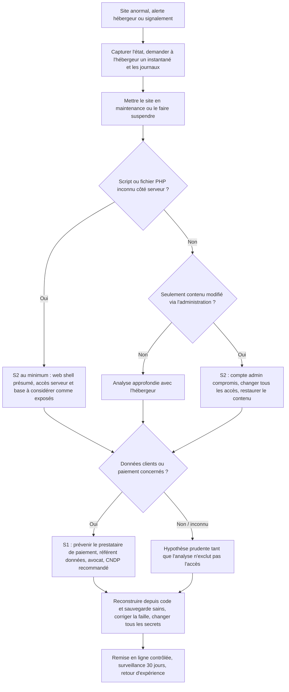

# Playbook C — Compromission du site e-commerce (défiguration, web shell, fuite de données clients)

| Référence | Gravité par défaut | Fonctions CSF 2.0 | Propriétaire |
|---|---|---|---|
| AGS-PB-C | S2 (défiguration, web shell), S1 (fuite de données clients ou atteinte au paiement) | Detect, Respond (RS.MA, RS.AN, RS.MI, RS.CO), Recover (RC.RP, RC.CO) | RI, avec l'hébergeur |

**Contexte.** La boutique est une application PHP avec une base MariaDB, chez un hébergeur externe. AgriSouss n'a pas d'accès complet au serveur : en hébergement mutualisé, les journaux, instantanés et restaurations passent par le panneau d'hébergement ou le support. Le paiement par carte est délégué à une **page de paiement hébergée** par le prestataire de paiement (type CMI) : le site ne doit **jamais** stocker de numéro de carte. Si ce n'est pas le cas, l'incident devient S1 et le prestataire de paiement doit être prévenu.

**Variantes.** (1) Défiguration : page d'accueil remplacée. (2) Web shell : script PHP déposé permettant à l'attaquant de commander le serveur, souvent via un formulaire d'envoi de fichiers, un module non à jour ou un mot de passe d'administration volé. (3) Fuite de données : base clients extraite (injection SQL, sauvegarde laissée accessible, identifiants de base volés). (4) Script malveillant injecté dans les pages (redirection, faux formulaire de paiement).

## 1. Déclencheurs et sources de détection

| Source | Signal |
|---|---|
| Client / visiteur | Page modifiée, redirection vers un autre site, alerte du navigateur « site dangereux », faux formulaire de paiement |
| Hébergeur | Notification d'abus, suspension, alerte de l'antivirus du serveur, consommation anormale |
| Supervision | Supervision de disponibilité ou de contenu (changement de la page d'accueil), alerte de contrôle d'intégrité des fichiers |
| Google Search Console | Alerte « site piraté » ou « problèmes de sécurité » |
| Journaux du serveur web | Requêtes POST vers des fichiers PHP inconnus, nombreuses erreurs 500, requêtes avec motifs d'injection SQL, connexions à l'administration depuis des IP inconnues |
| Externe | Base de données mise en vente ou publiée, clients qui reçoivent des hameçonnages très ciblés, signalement d'un chercheur ou du maCERT |
| Prestataire de paiement | Signalement de fraudes à la carte dont le point commun est la boutique |

## 2. Triage

- [ ] Ouvrir l'entrée au registre ; capturer l'écran du site (date/heure visibles) et noter les URL concernées.
- [ ] Quelle variante ? Défiguration, fichier suspect, redirection/script injecté, fuite de données, combinaison ?
- [ ] Le **paiement** est-il concerné (page de paiement modifiée, formulaire de carte ajouté) ?
- [ ] La **base clients** est-elle accessible à l'attaquant (identifiants de base dans un fichier de configuration lisible par un web shell = à considérer comme exposée) ?
- [ ] Appeler l'**hébergeur** : demander instantané/sauvegarde du compte **dans son état actuel**, export des journaux d'accès et d'erreurs, état de leurs propres alertes.
- [ ] Fixer la gravité ; S1 si données personnelles ou paiement probables.

## 3. Arbre de décision

## 4. Confinement

1. **Préserver avant de nettoyer** : demander à l'hébergeur un instantané du compte (fichiers + base) et l'export des journaux. Supprimer un web shell sans copie détruit la preuve et la compréhension de l'attaque.
2. **Mettre le site en maintenance** (page statique) ou demander une suspension temporaire, surtout s'il distribue du code malveillant ou un faux formulaire de paiement.
3. **Changer tous les accès** depuis un poste sain : panneau d'hébergement, FTP/SFTP, SSH, comptes administrateurs de la boutique, utilisateur MariaDB (mettre à jour le fichier de configuration), clés d'API (paiement, transporteurs, courriel transactionnel).
4. Supprimer les **comptes administrateurs inconnus** de la boutique et de la base après capture.
5. Bloquer temporairement l'accès à l'administration de la boutique par adresse IP ou authentification supplémentaire si l'hébergeur le permet.
6. Prévenir le **prestataire de paiement** si la page de paiement ou les redirections vers elle ont pu être modifiées.

## 5. Éradication

- [ ] Comparer les fichiers du serveur avec une **source de référence** (dépôt Git, archive de livraison du développeur) : fichiers ajoutés, modifiés, dates récentes, PHP dans les dossiers d'images ou d'envoi de fichiers.
- [ ] Rechercher dans la base : comptes administrateurs ajoutés, contenus modifiés, scripts insérés dans les pages ou paramètres.
- [ ] Analyser les journaux pour trouver le **vecteur** : requête d'exploitation, connexion admin réussie depuis une IP inconnue, envoi de fichier suspect.
- [ ] Corriger la **cause racine** : mise à jour du code / des modules, requêtes préparées contre l'injection SQL, contrôle des types de fichiers envoyés et interdiction d'exécuter du PHP dans le dossier d'envoi, mots de passe forts + MFA sur l'administration.
- [ ] Ne **pas** se contenter de supprimer le fichier malveillant visible : un attaquant laisse souvent plusieurs accès.

## 6. Rétablissement

- [ ] Reconstruire le site à partir du **code de référence** corrigé et d'une **sauvegarde de base saine** (antérieure à l'intrusion), en réintégrant les commandes légitimes passées depuis (à partir des exports du prestataire de paiement ou de la compta).
- [ ] Vérifier : pas de fichier inconnu, page de paiement conforme, en-têtes de sécurité, TLS valide.
- [ ] Remettre en ligne ; demander le réexamen dans Google Search Console si le site a été signalé.
- [ ] Surveillance renforcée 30 jours : intégrité des fichiers, connexions admin, erreurs, disponibilité.

Préparation (CSF *Protect*) : code sous Git ; sauvegarde quotidienne fichiers + base conservée hors de l'hébergeur ; mises à jour mensuelles ; MFA sur l'administration ; compte de base de données à privilèges minimaux ; pas de données de carte sur le site ; supervision de disponibilité et de contenu ; pare-feu applicatif (WAF) si disponible ; contrat d'hébergement qui précise rétention des journaux et délai d'intervention.

## 7. Preuves à collecter

| Preuve | Où | Remarque |
|---|---|---|
| Captures du site (page défigurée, redirection) | Navigateur d'un poste sain | Date/heure visibles, URL |
| Instantané complet fichiers + base à l'état compromis | Hébergeur | SHA-256 de l'archive reçue |
| Journaux d'accès et d'erreurs du serveur web | Hébergeur / panneau | Période : au moins 30 à 90 jours avant détection si disponible |
| Journaux FTP/SFTP/SSH, panneau d'hébergement | Hébergeur | Connexions et envois de fichiers |
| Fichiers suspects (web shell) | Copie dans l'archive, **pas** exécutés | Conserver chemin, dates, propriétaire |
| Liste des comptes admin et des modifications en base | Export SQL | Avant suppression |
| Échanges avec l'hébergeur et le prestataire de paiement | Messagerie | Numéros de ticket |
| Preuve de publication de la base (si fuite) | Capture de l'annonce | Ne pas télécharger ni acheter la base |

## 8. Modèles de communication

### 8.1 Message aux salariés

> **Objet : [Sécurité] Boutique en ligne temporairement en maintenance**
>
> Bonjour,
>
> Notre boutique en ligne est mise en maintenance suite à un incident de sécurité en cours d'analyse avec notre hébergeur. Les commandes peuvent être prises par téléphone au [numéro] / par courriel à [adresse].
>
> Merci de ne pas commenter l'incident auprès des clients ou sur les réseaux sociaux ; orientez toute question vers [nom du gérant]. Une note sera communiquée aux clients par la direction.
>
> [Nom], Responsable informatique

### 8.2 Courriel aux clients (en cas de fuite de données avérée ou probable)

> **Objet : Information sur un incident de sécurité concernant votre compte client AgriSouss**
>
> Madame, Monsieur,
>
> Le [date], nous avons détecté un accès non autorisé à notre boutique en ligne. Nous avons immédiatement mis le site en maintenance, sécurisé nos systèmes avec notre hébergeur et engagé une analyse.
>
> **Données concernées :** [nom, adresse électronique, adresse de livraison, téléphone, historique de commandes, mot de passe chiffré].
> **Données non concernées :** vos données de carte bancaire, qui sont saisies uniquement sur la page sécurisée de notre prestataire de paiement et ne sont pas stockées par AgriSouss. [Ne laisser cette phrase que si elle est vérifiée.]
>
> **Ce que nous vous recommandons :**
> - changer votre mot de passe sur notre site à sa réouverture, et sur tout autre site où vous utilisez le même ;
> - vous méfier des courriels, SMS ou appels se présentant comme AgriSouss et demandant un paiement ou des informations ;
> - nous signaler tout message suspect à [adresse].
>
> Nous avons [porté plainte / informé la CNDP — selon les démarches effectives]. Nous regrettons sincèrement cet incident. Pour toute question : [contact dédié, téléphone].
>
> [Nom], Gérant — AgriSouss SARL

## 9. Check-list post-incident

- [ ] Chronologie : vulnérabilité exploitée, date de l'intrusion, actions de l'attaquant, détection, remise en ligne.
- [ ] Faille corrigée et vérifiée ; tous les secrets changés.
- [ ] Périmètre de la fuite établi (tables, nombre de personnes, champs) ; décision CNDP, information des clients, RGPD si clients UE : documentées avec avis juridique.
- [ ] Prestataire de paiement informé si concerné ; plainte déposée si fuite ou fraude.
- [ ] Contrat d'hébergement revu (journaux, sauvegardes, délai d'intervention).
- [ ] Plan d'actions : mises à jour, revue de code, supervision d'intégrité, audit externe passif (voir projet RSSI Audit).

## 10. Indicateurs (KPI)

| Indicateur | Définition | Cible |
|---|---|---|
| MTTD | Délai entre l'intrusion (déterminée a posteriori dans les journaux) et la détection | < 24 h (défiguration : < 1 h avec supervision de contenu) |
| MTTC | Délai entre la détection et la mise en maintenance + changement des accès | < 2 h |
| MTTR | Délai entre la détection et la remise en ligne sécurisée | < 3 jours ouvrés |
| Délai d'information des clients | Délai entre la confirmation d'une fuite et l'information des personnes | Le plus court possible, objectif < 72 h |
| Délai de mise à jour | Délai moyen entre la publication d'un correctif de sécurité et son application | < 14 jours (< 72 h si exploité activement) |
